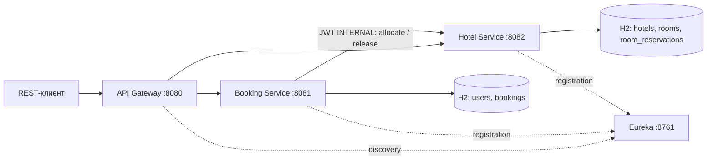
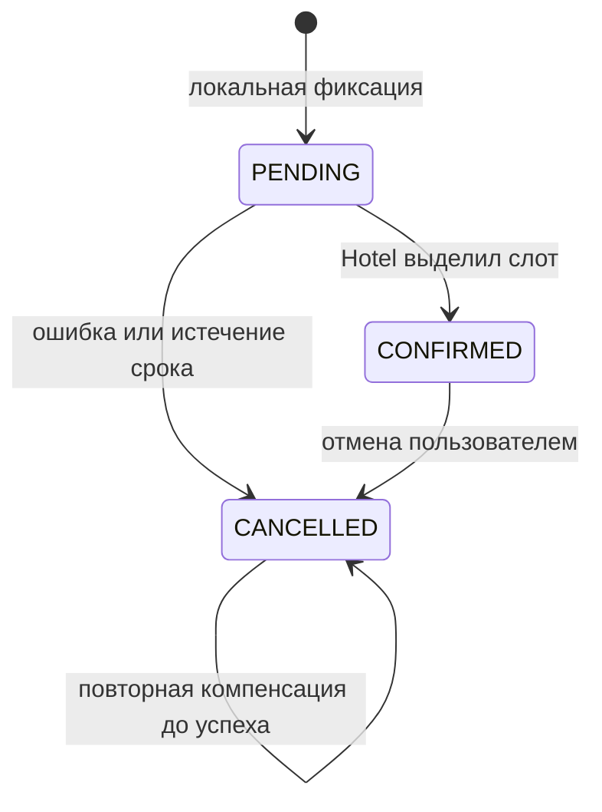

# Hotel Booking API

REST API бронирования отелей на Java 17+, Spring Boot 3.5.16 и Spring Cloud 2025.0.3. Четыре самостоятельных приложения: Gateway, Eureka, Booking Service и Hotel Service. Каждый бизнес-сервис использует свою H2 in-memory БД.

Система поддерживает JWT, роли USER/ADMIN, каталог отелей и номеров, подбор по минимальному числу бронирований, календарь занятости, идемпотентность, компенсацию при сбоях и статистику загрузки.

## Архитектура



| Модуль | Назначение | Документация |
|---|---|---|
| `gateway` | Маршрутизация `lb://`, JWT, запрет внутренних маршрутов, traceId | [README](gateway/README.md) |
| `discovery-server` | Реестр Eureka | [README](discovery-server/README.md) |
| `booking-service` | Пользователи, токены, бронирования, оркестрация саги | [README](booking-service/README.md) |
| `hotel-service` | Каталог, календарь, распределение, аналитика | [README](hotel-service/README.md) |
| `common` | Общие ошибки, JWT и корреляция HTTP | [README](common/README.md) |

Зависимости подключаются Maven автоматически. Lombok/MapStruct не требуются: DTO представлены Java records, преобразования короткие и явные. Совместимость версий указана в [таблице Spring Cloud](https://spring.io/projects/spring-cloud/).

## Быстрый запуск

Нужен **JDK 17 или 21** (рекомендуется 21), доступ к Maven Central, `curl`, `openssl`. Maven устанавливать отдельно не нужно: в проекте есть Maven Wrapper 3.9.11. Для smoke-теста нужен Python 3 без дополнительных пакетов. Первый запуск скачивает зависимости.

```bash
java -version
./mvnw -B verify
./scripts/start.sh
python3 scripts/smoke.py
./scripts/stop.sh
```

Скрипт запуска создаёт `.env` со случайным `JWT_SECRET`, собирает JAR при их отсутствии, запускает четыре процесса и проверяет `/actuator/health`. Логи и PID находятся в `.run/`. После изменения кода выполните `./mvnw package`, затем перезапустите стенд. После старта регистрация и обновление кэшей Eureka происходят асинхронно. Перед изменением данных smoke-тест до 120 секунд ожидает успешных GET-запросов по обоим путям: Gateway → Hotel и Gateway → Booking → Hotel.

Если стандартные порты заняты, задайте в `.env` `GATEWAY_PORT=18080`, `BOOKING_PORT=18081`, `HOTEL_PORT=18082`, `DISCOVERY_PORT=18761`. Для smoke-теста укажите `API_BASE_URL=http://localhost:18080 python3 scripts/smoke.py`. Эти параметры также меняют опубликованные порты Docker Compose.

На macOS при установленном по умолчанию Java 26 переключите `JAVA_HOME` на JDK 21, например `export JAVA_HOME=$(/usr/libexec/java_home -v 21)`. На Windows используйте `mvnw.cmd verify` и четыре терминала для запуска JAR, задав одинаковый `JWT_SECRET` в каждом.

| Адрес | Назначение |
|---|---|
| `http://localhost:8080` | Публичный REST API через Gateway |
| `http://localhost:8761` | Панель Eureka, локальное подключение |
| `http://localhost:8081/swagger-ui/index.html` | Swagger Booking Service |
| `http://localhost:8082/swagger-ui/index.html` | Swagger Hotel Service |
| `http://localhost:8080/docs/booking` | OpenAPI Booking через Gateway с JWT |
| `http://localhost:8080/docs/hotel` | OpenAPI Hotel через Gateway с JWT |

В Swagger нажмите **Authorize** и вставьте JWT. Документация и `/actuator/health` бизнес-сервисов доступны без токена; бизнес-операции защищены.

### Docker Compose

Нужны Docker Engine/Desktop и Compose v2:

```bash
./scripts/init-env.sh
docker compose up --build -d
python3 scripts/smoke.py
docker compose logs -f
docker compose down
```

Порты в Compose опубликованы только на `127.0.0.1`. Не запускайте локальные JAR и Compose одновременно на тех же портах. Для ручной настройки скопируйте `.env.example` в `.env` и замените `JWT_SECRET` результатом `openssl rand -hex 32`.

## Демонстрационные данные

При `SEED_DATA=true` создаются пользователи `admin / admin12345` (ADMIN) и `user / user12345` (USER), два отеля, номера с разными ценами и вместимостью; один номер выведен из эксплуатации. Значения паролей можно задать переменными `DEMO_ADMIN_PASSWORD` и `DEMO_USER_PASSWORD`. При `SEED_DATA=false` демонстрационные записи не создаются.

В H2 данные существуют только во время работы процесса. Перезапускайте весь стенд согласованно. Отдельный перезапуск Hotel или Booking очищает одну из баз и может нарушить соответствие бронирований и календаря. Подробности — в [ADR 001](docs/adr/001-service-boundaries.md).

## Пример использования

Получите токен:

```bash
TOKEN=$(curl -fsS http://localhost:8080/api/auth/login \
  -H 'Content-Type: application/json' \
  -d '{"username":"user","password":"user12345"}' \
  | python3 -c 'import sys,json; print(json.load(sys.stdin)["accessToken"])')

curl -fsS http://localhost:8080/api/hotels \
  -H "Authorization: Bearer $TOKEN"
```

Создайте бронирование, указав будущие даты (пример нужно скорректировать к дате запуска):

```bash
curl -i http://localhost:8080/api/bookings \
  -H "Authorization: Bearer $TOKEN" \
  -H 'Content-Type: application/json' \
  -H 'X-Trace-Id: demo-booking-001' \
  -d '{
    "requestId":"6eabbd78-1e47-4ee7-b5db-c8f709232001",
    "hotelId":1,
    "autoSelect":true,
    "startDate":"2027-06-10",
    "endDate":"2027-06-13"
  }'
```

`autoSelect=true` выбирает свободный номер в указанном отеле; `roomId` не участвует в выборе. При `autoSelect=false` обязательно передать `roomId`. Новый успешный запрос возвращает 201 и `CONFIRMED`. Повтор с тем же `requestId` и данными возвращает то же бронирование (200; 202, если первый запрос ещё выполняется). Тот же ключ с другими данными — 409. Ключ действует в рамках пользователя. Для новой попытки после отмены нужен новый UUID.

```bash
curl -fsS 'http://localhost:8080/api/bookings?page=0&size=20' \
  -H "Authorization: Bearer $TOKEN"
curl -fsS -X DELETE 'http://localhost:8080/api/bookings/BOOKING_UUID' \
  -H "Authorization: Bearer $TOKEN"
```

Отмена сохраняет историю и переводит состояние в `CANCELLED`. Изменение дат реализуется отменой и новым бронированием. Список показывает только собственные бронирования; ADMIN может получить отдельное бронирование по ID. Чужие записи скрываются от USER ответом 404.

## Публичные эндпойнты

Имена из примерного ТЗ приведены к единому REST-префиксу `/api`: `/user/register` → `/api/auth/register`, `/user/auth` → `/api/auth/login`, `/booking` и `/bookings` → `/api/bookings`.

| Метод и путь | Доступ | Назначение |
|---|---|---|
| `POST /api/auth/register` | Все | Регистрация USER и выдача JWT |
| `POST /api/auth/login` | Все | Вход и JWT на один час |
| `GET, POST /api/users` | ADMIN | Список / создание пользователей |
| `GET, PATCH, DELETE /api/users/{id}` | ADMIN | Чтение / пароль и роль / деактивация пользователя |
| `GET, POST /api/bookings` | USER, ADMIN | Своя история / создание |
| `GET, DELETE /api/bookings/{id}` | Владелец, ADMIN | Чтение / отмена |
| `GET /api/bookings/recommendations` | USER, ADMIN | Рекомендации через Booking |
| `GET /api/hotels`, `GET /api/hotels/{id}` | USER, ADMIN | Каталог отелей |
| `POST /api/hotels`, `PUT, DELETE /api/hotels/{id}` | ADMIN | Управление отелями |
| `GET /api/rooms`, `GET /api/rooms/{id}` | USER, ADMIN | Каталог номеров |
| `GET /api/rooms/recommend` | USER, ADMIN | Свободные номера по `timesBooked, id` |
| `POST /api/rooms`, `PUT, DELETE /api/rooms/{id}` | ADMIN | Управление номерами |
| `GET /api/hotels/{id}/statistics` | ADMIN | Загрузка за период и по номерам |

Пагинация: `page` с нуля, `size` по умолчанию 20, максимум 100, `sort=field,asc|desc`. Отели фильтруются по `name`, `city`. Номера — по `hotelId`, `startDate/endDate`, `available`, `minCapacity`, `minPrice/maxPrice`; сортировки: `id`, `number`, `timesBooked`, `pricePerNight`, `capacity`.

Для рекомендаций и статистики обязательны `startDate`, `endDate`. При поиске номеров даты можно опустить: тогда отображается операционная доступность без проверки конкретного периода. Даты передаются в формате `YYYY-MM-DD`, интервал `[startDate,endDate)`; заезд в день выезда другого гостя разрешён.

`available=false` означает ремонт/вывод из эксплуатации, а не занятость гостем. Занятость проверяется по календарю. Номер или отель с историей размещений физически не удаляется (409), номер можно отключить через PUT. Пользователи деактивируются с сохранением истории и отменой активных бронирований.

### Внутренние эндпойнты Hotel

Доступны только напрямую с сервисным JWT роли INTERNAL; Gateway запрещает их для всех:

| Метод и путь | Назначение |
|---|---|
| `POST /api/rooms/allocate` | Атомарный автоподбор либо выделение указанного номера |
| `POST /api/rooms/{id}/confirm-availability` | Выделение конкретного номера |
| `POST /api/rooms/release` | Компенсация, в том числе при неизвестном `roomId` |
| `POST /api/rooms/{id}/release` | Компенсация конкретного номера |

Контракт и примеры JSON — в [документации Hotel](hotel-service/README.md). В каждом вызове есть `bookingId`; повторное выделение не увеличивает счётчик повторно. Освобождение сохраняет терминальную запись, поэтому позднее подтверждение после тайм-аута не может снова занять слот.

## Согласованность и распределение



Сетевых вызовов внутри транзакций Booking нет. Hotel блокирует строку отеля в БД, проверяет пересечения и фиксирует календарь одной транзакцией. Автоподбор сортирует доступные номера по возрастанию `times_booked`, при равенстве — по ID. Счётчик хранит число успешных выделений и не уменьшается при отмене.

Booking ограничивает время HTTP-вызова, повторяет временные ошибки с растущей задержкой и использует circuit breaker. Ошибка выделения отменяет бронирование. Если освобождение временно не удалось, `compensationRequired=true`, а фоновый обработчик повторяет его с паузой 5 секунд между проходами. Он отбирает `PENDING` старше 30 секунд для отмены; фактическая задержка зависит также от длительности сетевых вызовов и очереди восстановления.

Подробные решения: [границы сервисов](docs/adr/001-service-boundaries.md), [сага и восстановление](docs/adr/002-saga-and-recovery.md), [алгоритм распределения](docs/adr/003-room-allocation.md), [безопасность](docs/adr/004-security.md), [схема БД](docs/database.md).

## Ошибки и трассировка

Единая форма ошибки:

```json
{
  "timestamp":"2026-11-08T12:00:00Z",
  "status":409,
  "code":"ROOM_UNAVAILABLE",
  "message":"Requested room is unavailable",
  "path":"/api/bookings",
  "traceId":"demo-booking-001",
  "details":{}
}
```

400 — неверные данные; 401 — нет/неверен JWT или неверные учётные данные; 403 — недостаточно прав; 404 — объект не найден/чужая бронь; 409 — пересечение, конфликт идемпотентности или удаление объекта с историей; 503 — временная недоступность Hotel.

`X-Trace-Id` проходит через Gateway и сервисы и возвращается клиенту. При отсутствии или некорректном значении создаётся новый UUID. Логи — JSON; ключевые события бронирования включают `bookingId`. JWT и пароли не логируются. Состояние после 503 можно найти в истории либо повторным POST с тем же `requestId`.

## Проверка

```bash
./mvnw -B verify                         # JUnit + проверка форматирования
python3 -m unittest discover -s scripts -p 'test_*.py'  # проверка ожидания готовности
./mvnw spotless:apply                    # применить единый Java-стиль
./mvnw -pl hotel-service -am test         # Hotel и его зависимости
./mvnw -pl booking-service -am test       # Booking и его зависимости
./mvnw -pl gateway,discovery-server -am test
./scripts/start.sh
python3 scripts/smoke.py                 # реальные HTTP-запросы через все 4 сервиса
python3 scripts/fault-smoke.py           # потеря ответов и восстановление компенсации
./scripts/stop.sh
```

JUnit-тесты не требуют Docker, внешних БД или запущенного Eureka. Используются отдельные H2, MockMvc, WebTestClient и локальные HTTP-заглушки. Проверяются подпись/срок/issuer/audience JWT, роли и принадлежность, даты, CRUD, параллельные выделения, идемпотентность, равномерность, пересечения, тайм-ауты, повторы, компенсация и восстановление.

`smoke.py` создаёт собственный тестовый отель, выполняет гонку из 12 запросов на один номер и проверяет ровно одно подтверждение, затем проверяет равномерность распределения и статистику. Его можно повторять на одном стенде. `fault-smoke.py` запускает отдельный Booking JVM и прокси с контролируемыми сбоями: Hotel действительно занимает номер, ответ теряется, освобождение сначала недоступно, затем фоновая компенсация восстанавливает календарь. Нужны запущенный Hotel, собранный Booking JAR и `.env`. Скрипт завершает свои дополнительные процессы автоматически.

Отчёты Maven находятся в `*/target/surefire-reports`. CI повторяет `verify` и сквозной smoke-тест; сценарии по критериям перечислены в [матрице проверок](docs/testing.md).

Результаты выполненных проверок: [76 тестов и сквозные сценарии](docs/verification.md).
