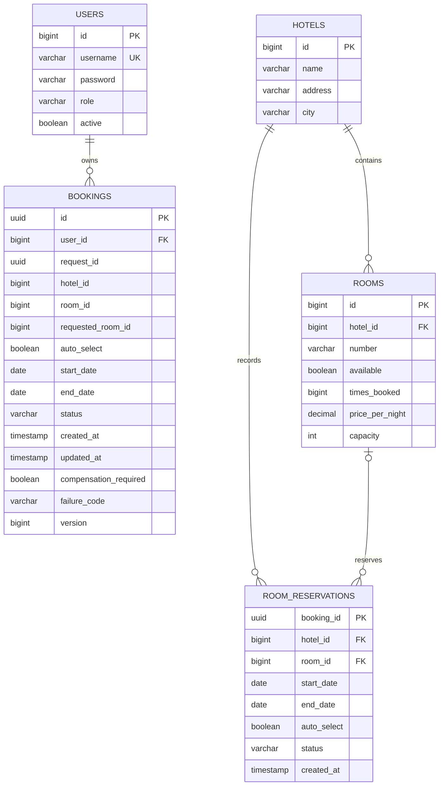

# Схема данных

Схема создаётся Hibernate (`ddl-auto=create-drop`) из JPA-сущностей. H2 используется отдельно в Booking и Hotel. Общая БД и межсервисные внешние ключи отсутствуют.

## Booking

- `users.id`: генерируемый идентификатор; `username` уникален; `password` — BCrypt-хеш; `role` USER/ADMIN; `active` поддерживает деактивацию без удаления истории.
- `bookings.id`: UUID, одновременно корреляционный ключ межсервисной операции.
- Уникальный индекс `(user_id,request_id)` предотвращает повторные клиентские бронирования. Перед созданием блокируется пользователь, обеспечивая корректный ответ и при параллельном повторе.
- `requested_room_id` хранит исходное предпочтение для проверки идемпотентности; при автоподборе null. `room_id` становится известен после подтверждения Hotel.
- Индексы `(user_id,created_at)`, `(status,created_at)`, `compensation_required` обслуживают историю и фоновые выборки.
- `version` — оптимистическая версия; изменения состояния дополнительно защищены блокировкой строки.
- `compensation_required` и `failure_code` фиксируются вместе с отменой. Это очередь восстановления в той же БД, без брокера.

## Hotel

- `hotels`: название, адрес, город; строка отеля — область сериализации операций календаря.
- `rooms`: внешний ключ отеля, уникальная пара `(hotel_id,number)`, флаг операционной доступности, число успешных выделений, цена и вместимость. Индексы поддерживают фильтрацию и выбор наименее использованного номера.
- `room_reservations`: локальная проекция календаря с ключом `booking_id`; `ACTIVE` занимает интервал, `RELEASED` не занимает.
- Индексы `(room_id,status,start_date,end_date)` и `(hotel_id,status)` обслуживают пересечения и аналитику.
- В компенсирующей записи, созданной раньше подтверждения, `room_id/start_date/end_date` могут быть null: это запрет на последующее выделение по тому же `booking_id`.

Статистика `bookedNights` считает пересечение ACTIVE-интервалов с периодом отчёта; отменённые записи исключаются. `roomNights` — число всех номеров × число ночей периода; `occupancyPercent` — доля занятых ночей в этой ёмкости. `operationalRooms` отдельно показывает текущие доступные номера. `totalBookings` — историческая сумма `times_booked`, а не число бронирований только за период.
